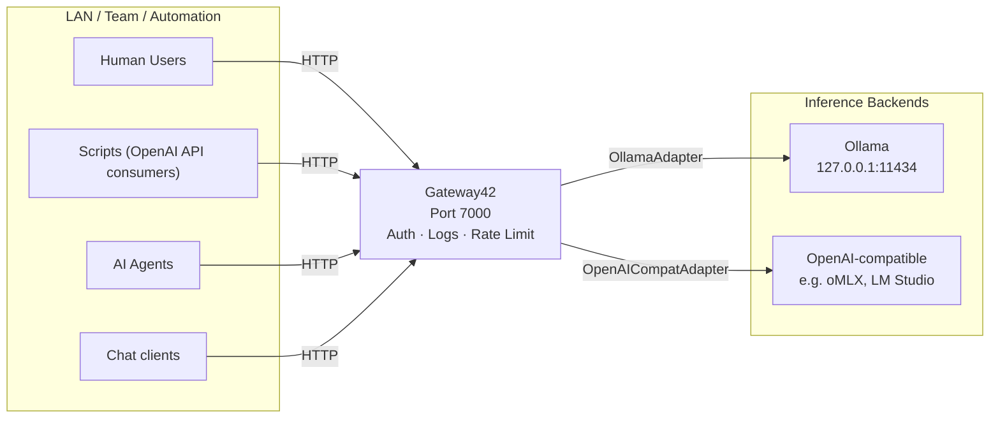

# Gateway42. — An opinionated AI gateway

**Authenticated, audited, rate-limited API gateway for local and remote LLMs. On-prem. Privacy-first.**

Gateway42. sits between your users and your AI inference backends, exposing an **OpenAI-compatible API** while adding authentication, per-user rate limiting, and full request logging. It supports both local [Ollama](https://ollama.com) instances and any remote **OpenAI-compatible endpoint** — LM Studio, oMLX, or the real OpenAI API. Any client or library built for the OpenAI API works with Gateway42. without code changes — just swap the base URL and API key.


## Contents

- [Architecture](#architecture) · [Request pipeline](#request-pipeline)
- [What Gateway42. adds](#what-gateway42-adds) · [Design philosophy](#design-philosophy)
- [Quick start](#quick-start-not-for-production) · [Install as a service](#installing-gateway42-as-a-service-launchd)
- [Multi-engine support](#multi-engine-support) · [Engine selection](#engine-selection)
- [API reference](#api-reference) · [Claude Code / Anthropic API](#claude-code--anthropic-messages-api) · [Parameters](#parameters) · [Streaming](#streaming) · [Error codes](#error-codes)
- [Rate limiting](#rate-limiting) · [Token quotas](#token-quotas) · [Concurrency and load shedding](#concurrency-and-load-shedding)
- [Observability](#observability) · [Security model](#security-model) · [Storage and data handling](#storage-and-data-handling)
- [Admin dashboard](#admin-dashboard) · [Audit logs](#audit-logs)
- [Configuration](#configuration) · [Timeouts and limits](#timeouts-and-limits)
- [Development](#development) · [Known design constraints](#known-design-constraints)

## Architecture



You can run Gateway42. on the same machine as Ollama, with Ollama listening only on `127.0.0.1:11434` and never exposed over the LAN. Or point it at a remote OpenAI-compatible endpoint. Either way, all external access goes through the gateway.

### Request pipeline

Every request passes through the same middleware chain, outermost first. The order is deliberate:

| # | Middleware | Responsibility |
| - | ---------- | -------------- |
| 1 | `metricsMiddleware` | Records count, latency, and the in-flight gauge. Outermost so that a panic recovered below it has already resolved into a status by the time it measures. |
| 2 | `recoveryMiddleware` | Converts a panic in any handler below it into a response instead of a dropped connection, picking the response format from the path and from whether the response was already committed. |
| 3 | `corsMiddleware` | Applies CORS headers so browser-based OpenAI clients work. |
| 4 | `apiAuthMiddleware` | Resolves the Bearer token to a user once, for `/v1/*`, and puts it in the request context. |
| 5 | `rateLimitMiddleware` | Draws one token from the caller's per-minute bucket for every `/v1/*` request, rejecting an empty bucket before any handler runs. It reads the user step 4 put in the context — there is no bucket to draw from until a user is resolved — and answers in the path's own error envelope. No `Retry-After`: the bucket refills gradually across the minute, so any fixed "wait until" would be a guess. |
| 6 | `csrfMiddleware` | Rejects state-changing admin requests without a valid token — before any handler mutates state. |
| 7 | `requestLoggingMiddleware` | Writes the HTTP request log. Runs innermost so it can read the user resolved in step 4. |

Auth before rate limiting, and both before CSRF and before logging: the limiter needs the user
step 4 resolved to know whose bucket to draw from, and the request log needs that same context to
name the user who made the call and record the status a rejection actually produced.

The first two are the pair that is easy to get backwards. Middleware defers unwind inside-out, so
the layer that *writes* the panic response has to sit inside the layer that *measures* it. With
recovery outermost — the intuitive arrangement — a panic unwound through `metricsMiddleware` before
recovery ever saw it, and recovered panics were simply absent from the request count and the latency
histogram. Recording in a `defer` alone does not fix that; it only changes the symptom, because
metrics would then observe before recovery had written anything. Metrics outermost and recovery
second is what makes the two agree.

The cost of that ordering is that a panic in `metricsMiddleware` itself is no longer caught by the
application. It falls through to `net/http`'s per-connection recovery, which drops that one
connection and logs it — the process survives. That layer is a dozen lines of Prometheus calls with
label counts fixed at compile time, so the exposure is deliberately kept small.

All three layers that need the status code — metrics, recovery, and the request log — share a single
`statusRecorder`, installed by whichever runs first. They previously wrapped the writer one each,
which stacked three recorders per request and left only the innermost seeing the handler's own
`WriteHeader`.


## What Gateway42. adds

| Capability              | Ollama  | Gateway42 |
| ----------------------- | ------- | --------- |
| LAN API                 | No      | Yes       |
| OpenAI-compatible API   | No      | Yes       |
| Multiple engine backends| No      | Yes       |
| Model-aware routing     | No      | Yes       |
| API key auth            | No      | Yes       |
| Per-user isolation      | No      | Yes       |
| Rate limiting           | No      | Yes       |
| Token quotas            | No      | Yes       |
| Upstream load shedding  | No      | Yes       |
| AI interaction logging  | No      | Yes       |
| HTTP request logging    | No      | Yes       |
| Log retention policy    | No      | Yes       |
| CSV audit export        | No      | Yes       |
| Full-text log search    | No      | Yes       |
| Prometheus metrics      | No      | Yes       |
| Admin dashboard         | No      | Yes       |


## Design philosophy

- All access is **authenticated** via API keys — no unauthenticated requests reach the engine
- All API traffic is **logged** at the HTTP level for auditability, with AI interaction logs per user
- Rate limits **protect system stability** and prevent any single user from monopolizing inference
- The admin UI exists for **governance only**, not inference
- Inference backends stay **behind the gateway** — whether local or remote, they are never directly reachable by end users


## Quick start (not for production)

**Prerequisites:**

- Go 1.25 or newer (see `go.mod`)
- At least one inference backend: [Ollama](https://ollama.com/download) running locally, or an OpenAI-compatible endpoint

No C toolchain is needed. Gateway42. uses a pure-Go SQLite driver (`modernc.org/sqlite`), so it
builds and runs without cgo — which also means `go test -race` works out of the box.

```bash
# 1. Build and start
go build -o gateway42 .
./gateway42

# 2. Open the admin UI and configure your first engine
open http://localhost:7000
```

> Default admin password is `admin123`. Change it after first login via the admin UI — logging in
> with the default locks the rest of the dashboard to the change-password form until you do.

After logging in, go to **Settings** to add your first engine (Ollama or OpenAI-compatible) before making API calls.


## Installing Gateway42. as a service (launchd)

Install Gateway42. as a persistent background service that starts automatically at login:

```bash
./install.sh
```

The script will:
- Build the binary if needed
- Install it to `/usr/local/bin/gateway42`
- Create data directories at `~/.gateway42/` and `~/Library/Logs/gateway42/`
- Register and start a LaunchAgent (`com.gateway42.service`)

**Service management** — use the included `gateway42-service.sh` script:

```bash
./gateway42-service.sh start
./gateway42-service.sh stop
./gateway42-service.sh restart
./gateway42-service.sh status
```

Or directly with launchctl:

```bash
# View status, pid and last exit code
launchctl print gui/$(id -u)/com.gateway42.service

# Restart
launchctl kickstart -k gui/$(id -u)/com.gateway42.service

# Follow logs
tail -f ~/Library/Logs/gateway42/gateway.log

# Uninstall (removes binary and plist, preserves data)
./install.sh uninstall
```

The service restarts automatically on crash. It stops cleanly on `stop`.


## Multi-engine support

Gateway42. manages multiple inference engines from the admin **Settings** page. Two engine types are supported:

### Ollama

Point the gateway at a local (or LAN-accessible) Ollama instance. You need the host address and port (default: `11434`). The gateway talks to Ollama's native API and translates OpenAI-format requests automatically.

### OpenAI-compatible

Any endpoint that speaks the OpenAI API format — oMLX, LM Studio, vLLM, or the real OpenAI API. Provide the base URL and an API key if the endpoint requires one. Requests pass through directly without translation.

The base URL works with or without its `/v1` — `http://127.0.0.1:8000/v1` (how oMLX, LM Studio and the OpenAI SDKs write it) and `http://127.0.0.1:8000` reach the same endpoints. A path prefix in front of `/v1`, such as a proxy mount at `/openai/v1`, is kept.

### Engine selection

When a request arrives at `/v1/chat/completions`, Gateway42. routes it to an engine that actually holds the requested model. The routing table is built from the same health probes that feed the dashboard, so adding a model to an engine makes it routable without configuring anything — and without a restart. When several engines report the same model, the table stores them in insertion order — the engine added first is the primary, the rest are its failover targets — and the handler walks the list, taking a concurrency slot from the first engine that has one. If the primary is down or at its concurrency cap, the request falls through to the next engine holding the model instead of failing.

A request for a model that no reachable engine reports gets `404` rather than being forwarded somewhere it will fail, and a request gets `503` only when every engine holding the model is at its concurrency cap. The Anthropic routes (`/v1/messages`) still use the single-engine path: one engine serves, with no per-request failover, and a request to them without a `model` is rejected with `400` rather than guessed at.

You can add, edit, and remove engines from the Settings page — no restart required.


## API reference

Gateway42. exposes an **OpenAI-compatible API** and an **Anthropic Messages API**, so both OpenAI
clients and Claude Code / the Anthropic SDKs can use it.
Point a client at Gateway42. by changing the base URL and providing a Gateway42 API key.

### Base URL

```
http://<your-host>:7000/v1
```

### Authentication

Pass the user's API key as a Bearer token:

```
Authorization: Bearer <api_key>
```

Requests with a missing, invalid, or deactivated key are rejected with `401 Unauthorized`.

### Endpoints

| Endpoint | Method | Description |
| -------- | ------ | ----------- |
| `/v1/chat/completions` | POST | Chat completion. Accepts OpenAI-format bodies. Set `"stream": true` for SSE streaming. |
| `/v1/embeddings` | POST | Embeddings. OpenAI-format body (`model`, `input`, `dimensions`, `encoding_format`). OpenAI-compatible engines get it as-is; Ollama gets `/api/embed`, with `base64` encoded by the gateway. Ollama takes text input only, not token arrays. |
| `/v1/messages` | POST | Anthropic Messages API, translated onto the same engines — see [Claude Code](#claude-code--anthropic-messages-api). |
| `/v1/messages/count_tokens` | POST | Estimated input token count (≈ 4 bytes per token) in Anthropic format. |
| `/v1/models` | GET | Returns the combined catalogue of every reachable engine. Each entry carries both OpenAI (`object`, `owned_by`) and Anthropic (`type`, `display_name`, `created_at`) fields. Duplicates are collapsed; an engine that is down is skipped rather than failing the listing. |
| `/v1/whoami` | GET | Reports the identity the caller authenticated as: `name`, `status`, `rate_limit_rpm`, and `key_created_at`. A no-side-effect way for a key holder to verify credentials without reaching the admin UI. It is a `/v1/` route, so it goes through the same rate limiting as the other `/v1` endpoints. |
| `/health` | GET | Returns `{"status": "ok"}`. No auth required. Use for uptime monitoring. |
| `/metrics` | GET | Prometheus exposition. Requires an admin session cookie, or `Authorization: Bearer <GW42_METRICS_TOKEN>` when that variable is set — see [Observability](#prometheus-metrics). |

`OPTIONS` on any `/v1/` path is answered as a CORS preflight. Any other path under `/v1/` returns
`404` — the surface is deliberately just these endpoints.

### Example — cURL

```bash
curl http://<host>:7000/v1/chat/completions \
  -H "Authorization: Bearer <api_key>" \
  -H "Content-Type: application/json" \
  -d '{
    "model": "llama3.2:latest",
    "messages": [{"role": "user", "content": "Hello!"}]
  }'
```

### Example — Python (openai SDK)

```python
from openai import OpenAI

client = OpenAI(
    base_url="http://<host>:7000/v1",
    api_key="<api_key>",
)

response = client.chat.completions.create(
    model="llama3.2:latest",
    messages=[{"role": "user", "content": "Hello!"}],
)
print(response.choices[0].message.content)
```

### Claude Code / Anthropic Messages API

`POST /v1/messages` accepts Anthropic-format requests — system prompt, content blocks, images,
`tools`/`tool_choice`, `tool_use`/`tool_result` turns, streaming — and translates them onto the
OpenAI-shaped pipeline every engine already speaks. Rate limits, token quotas, concurrency slots,
metrics and the audit log are shared with `/v1/chat/completions`, and so is failover routing
(see [Engine selection](#engine-selection)). Errors on these paths use
Anthropic's envelope (`{"type":"error","error":{…}}`), with `not_found_error` for an unknown
model and `overloaded_error` when the engine is busy.

To run Claude Code through Gateway42.:

```bash
export ANTHROPIC_BASE_URL=http://<host>:7000
export ANTHROPIC_AUTH_TOKEN=<api_key>          # sent as Authorization: Bearer
# Claude Code asks for Claude model names by default; map every tier to a gateway model.
export ANTHROPIC_MODEL=<model-id-from-/v1/models>
export ANTHROPIC_DEFAULT_OPUS_MODEL=$ANTHROPIC_MODEL
export ANTHROPIC_DEFAULT_SONNET_MODEL=$ANTHROPIC_MODEL
export ANTHROPIC_DEFAULT_HAIKU_MODEL=$ANTHROPIC_MODEL
claude
```

Not translated: Anthropic server tools (`web_search`, `code_execution`, … — no local engine can run
them, so they are not offered to the model) and `top_k`. Claude Code relies heavily on tool calling, so use a model
that supports it. It also assumes a 200k context window for model IDs it does not recognise; see
the Claude Code model-config docs to set the real window for your model.

Translated with care:

- **Images in tool results** (screenshots from computer use and browser tools) travel in a user
  message right after the tool messages, labelled with their tool call, because OpenAI tool messages
  carry text only.
- **Documents**: plain-text and content documents are inlined with their title and context. PDFs
  cannot be read by a local engine, so they become a one-line note saying so, not silence.
- **Thinking**: when the request enables `thinking`, the engine's reasoning (`reasoning_content`,
  `reasoning`, or Ollama's `thinking`) is returned as `thinking` blocks, streamed as
  `thinking_delta`, with an empty signature. Without it, reasoning is dropped as before.
  Thinking blocks sent back in history are not forwarded. The setting also reaches the engine:
  `chat_template_kwargs.enable_thinking` is `true` for `enabled`/`adaptive` and `false` otherwise,
  since Anthropic's default is no thinking. Ollama gets `think: false` when thinking is off and
  nothing when it is on, because it rejects `think: true` for models that cannot think.
  `output_config.effort` (the app's Effort control) becomes `reasoning_effort`, with `max` sent as
  `high`. `chat_template_kwargs` is never sent to `api.openai.com`.
- **Parallel tool use**: `tool_choice.disable_parallel_tool_use` becomes `parallel_tool_calls: false`.
- **Failover**: `/v1/messages` tries every engine that holds the model, like `/v1/chat/completions`.

#### Prompt caching (Claude Desktop, Cowork, Claude Code)

Local engines (oMLX, vLLM, llama.cpp, LM Studio, Ollama) have no `cache_control` markers; they reuse
the KV cache for the longest prompt prefix they have already seen. Gateway42 keeps that working:

- **Stable prefix.** The `x-anthropic-billing-header: …; cch=…;` line that Claude clients put at
  the top of the system prompt changes on every request. Forwarded, it would make every turn miss
  the cache at the very first token and reprocess the whole conversation. Gateway42 drops it. The
  rest of the translation is deterministic, so tools, system prompt and earlier turns reach the
  engine byte-identical from turn to turn. `cache_control` itself is accepted and not forwarded.
- **Cache usage reported.** An engine's `usage.prompt_tokens_details.cached_tokens` becomes
  `cache_read_input_tokens`, with `input_tokens` holding only the tokens the engine had to process,
  and every response carries the `cache_creation` object Claude Desktop reads. To check caching,
  look for `cache_read_input_tokens` well above zero after a session's first request. Ollama does
  not report cache hits, so with Ollama it stays 0 even when the cache is used. The request log and
  the quota still count the whole prompt.

To use Gateway42 with Claude Desktop / Cowork, set `inferenceProvider` to `gateway`,
`inferenceGatewayBaseUrl` to the gateway's URL, `inferenceGatewayApiKey` to a Gateway42 key (either
auth scheme works) and list the local model IDs in `inferenceModels`. Model auto-discovery only
shows Claude model IDs, so local models must be listed explicitly; set `behavesAs` on an entry to
choose the context window the app assumes.

### Parameters

**When routing to an Ollama engine**, Gateway42. translates standard OpenAI parameters to their Ollama equivalents:

| OpenAI parameter | Ollama parameter | Notes |
| ---------------- | ---------------- | ----- |
| `model` | `model` | Must match an installed Ollama model name |
| `messages` | `messages` | Full conversation history |
| `stream` | `stream` | SSE streaming when `true` |
| `temperature` | `temperature` | |
| `top_p` | `top_p` | |
| `max_tokens` | `num_predict` | |
| `max_completion_tokens` | `num_predict` | Wins over `max_tokens` when both are sent — OpenAI treats `max_tokens` as this field's deprecated alias |
| `seed` | `seed` | |
| `stop` | `stop` | String or list of strings; a bare string is wrapped into a list |
| `presence_penalty` | `presence_penalty` | Direct — Ollama takes this parameter under its own name |
| `frequency_penalty` | `frequency_penalty` | Direct |
| `tools` | `tools` | Same schema, forwarded as-is. `tool_choice: "none"` withholds them; other `tool_choice` values are ignored (Ollama has no equivalent). |
| `response_format` | `format` | `json_object` → `"json"`; `json_schema` → the schema object. |

Tool calls come back in OpenAI shape: arguments as a JSON string, an `id` per call (Ollama does not
assign one, so Gateway42 does), an `index` per call when streaming, and `finish_reason: "tool_calls"`.
On the way in, the message history is converted to Ollama's shape — a tool result's `tool_call_id`
becomes the `tool_name` of the call it answers, and array content is split into text and `images`.
Only inline `data:` image URLs can be passed on; a remote image URL is dropped, since the gateway
does not fetch it. Whether a model actually calls tools depends on the model.

Anything else not in that table is **dropped rather than rejected**.

**When routing to an OpenAI-compatible engine**, the body is forwarded through an allow-list that
covers the standard fields plus the tool-calling and structured-output ones: `temperature`, `top_p`,
`seed`, `max_tokens`, `max_completion_tokens`, `frequency_penalty`, `presence_penalty`, `stop`, `n`,
`user`, `response_format`, `tools`, `tool_choice`, `parallel_tool_calls`, `logit_bias`, `logprobs`,
`top_logprobs`, `service_tier`, and `provider_options`. Parameters outside the list are dropped.
`stream` is always sent as an explicit boolean — `false` when the client omitted it — so the upstream
answers in the shape the gateway expects to read.
`stream_options` is added rather than forwarded: on a stream the gateway sets `include_usage` itself,
because an engine that was never asked for usage reports none and the request is then logged as free
rather than unmeasured. A client's own sub-fields are carried through; on a non-stream the field is
dropped. See [Streaming](#streaming) for what that means on the wire.
Whether an allowed parameter actually *works* depends on the upstream engine, not on Gateway42. —
LM Studio and vLLM support different subsets.

### Streaming

Set `"stream": true` to receive the completion as Server-Sent Events. Gateway42. normalises both
engine types to the OpenAI chunk format, so the same client code works against Ollama and against an
OpenAI-compatible upstream.

```
data: {"id":"chatcmpl-…","object":"chat.completion.chunk","choices":[{"index":0,"delta":{"role":"assistant","content":"Hel"},"finish_reason":null}]}

data: {"id":"chatcmpl-…","object":"chat.completion.chunk","choices":[{"index":0,"delta":{"content":"lo"},"finish_reason":null}]}

data: {"id":"chatcmpl-…","object":"chat.completion.chunk","choices":[{"index":0,"delta":{},"finish_reason":"stop"}],"usage":{"prompt_tokens":7,"completion_tokens":2,"total_tokens":9}}

data: [DONE]
```

What that guarantees:

- **The first chunk declares `"role": "assistant"`**; later chunks omit it, so a client that
  accumulates deltas does not restart the message.
- **`finish_reason` is present and `null`** on every chunk until the last one. It is a key that
  exists rather than a key that is missing — some SDKs fault on absence. On the last chunk it is
  `"length"` if the reply was cut off by `max_tokens`, otherwise `"stop"`.
- **`usage` appears only on the final chunk.** A client that sums usage across chunks gets the right
  total instead of over-counting. Which final chunk depends on the upstream: an Ollama engine's counts
  are folded into the terminating chunk above, while an OpenAI-compatible upstream is forwarded
  verbatim, so its usage arrives in OpenAI's own extra chunk — the one whose `choices` array is empty.
  The gateway asks compat engines for that figure with `include_usage`, so it arrives even when the
  client did not request it. Index `choices` defensively rather than assuming every chunk has one.
- **The stream always ends `data: [DONE]`**, even if the upstream closes without sending its own
  terminator.
- **Buffering is disabled** (`X-Accel-Buffering: no`, `Cache-Control: no-cache`) and every chunk is
  flushed, so tokens arrive as produced even behind nginx.

If the upstream fails *after* the stream has started, the HTTP status is already committed and
cannot be changed. Gateway42. emits an error-shaped frame and then terminates normally:

```
data: {"error": {"message": "Stream interrupted", "type": "api_error", "code": null}}

data: [DONE]
```

Treat a frame carrying `error` as a truncated completion rather than as content. There is no server
`WriteTimeout`, deliberately — a long generation is not a stalled connection.

A stream is bounded by **silence rather than elapsed time**: it is cut after 60 s in which the engine
sent nothing, and at 30 minutes however steadily tokens arrived. A completion that keeps producing is
never cut for running long, which is the part that matters — at the ~58 tokens/s measured on the local
engine, two minutes is only about 6,900 output tokens, routinely exceeded by an agent prompt on a
reasoning model. Non-streaming completions keep a single 120 s budget, because a response that sends
nothing until it is finished offers no other progress signal.

Hanging up mid-stream is handled: a client disconnect cancels the upstream call, which releases the
engine's concurrency slot immediately rather than waiting for the read to finish. A stream the gateway
had to cap is recorded in the request log with the reason in `upstream_error`, so a truncated answer
is distinguishable from a network failure without reading the process log.

### Error Codes

Errors use the OpenAI error envelope, so SDK error handling works unchanged:

```json
{"error": {"message": "Rate limit exceeded", "type": "rate_limit_error", "code": null}}
```

| Status | `type` | Meaning |
| ------ | ------ | ------- |
| `400` | `invalid_request_error` | Body is not valid JSON, or `messages` is missing |
| `401` | `authentication_error` | Missing, invalid, or deactivated API key |
| `404` | `invalid_request_error` | The requested model is not available on any reachable engine — including, on `/v1/chat/completions`, when no engine is reachable at all |
| `413` | `invalid_request_error` | Request body too large (over `GW42_MAX_REQUEST_BYTES`) |
| `429` | `rate_limit_error` | Per-minute rate limit exceeded, or daily token quota exhausted — wait before retrying |
| `502` | `api_error` | Gateway42. could not reach the engine, or the engine failed (5xx) or rejected the gateway's own engine credentials (401/403); also "no engines configured" on `/v1/models` and `/v1/messages` |
| `503` | `api_error` | Engine is at its concurrency cap — retry after the `Retry-After` interval |
| `500` | `api_error` | Internal server error, including a recovered panic. |

When the engine itself rejects a request, its verdict is passed on with the engine's own message instead of a 502: 400 and 422 become `400 invalid_request_error` (for example a prompt longer than the model's context window), and 404, 413 and 429 keep their status. On `/v1/messages` a context-window overflow is worded `prompt is too long: …`, the phrase Claude Code, Claude Desktop and Cowork match to compact the conversation and retry.
A panic inside a handler is recovered and reported rather than dropping the connection. How it is
reported depends on how far the response had already got:

- **Nothing written yet** — you get a normal `500` carrying the envelope above, so SDK error
  handling works the same as for any other failure.
- **Mid-stream** — the `200` and the SSE headers are already committed and the status cannot be
  changed, so the stream receives an error frame followed by `[DONE]`, identical in shape to an
  upstream stream failure. One client code path covers both.
- **Admin UI** — replies `text/plain`; the OpenAI envelope would be meaningless to the browser UI.

Two of these are worth distinguishing. A `404` is a **routing verdict** authored by Gateway42., not
a response relayed from an engine: it means the model appears on none of the engines the gateway
could reach. On `/v1/chat/completions` the verdict is about reachable engines, so with every engine
down — or none configured — the answer is a `404`: no reachable engine holds the model. A `502`
means the gateway picked an engine and it did not answer. The Anthropic routes, which still use the
single-engine path, keep the older rule: with every engine unreachable they fall back to the
default engine, so a total outage surfaces as `502` there rather than `404`.

Full error semantics, including how failures mid-stream are reported, are in
[OPENAI_COMPATIBILITY.md](OPENAI_COMPATIBILITY.md#errors).

### More help
Gateway42. has a built-in help page with additional information.


## Rate Limiting

Gateway42 enforces a per-user **token bucket**. A user configured for *N* requests per minute gets a
bucket of *N* tokens that refills continuously at *N* ÷ 60 tokens per second. Each request spends one
token; a request arriving at an empty bucket is rejected.

In practice: an idle user can burst up to *N* requests back to back, then sustains *N* per minute.
There is no window boundary to wait out — capacity returns gradually.

The limit is enforced in middleware rather than inside the completion handlers, so it covers every
`/v1/*` route — `/v1/models` and the Anthropic routes included, not just chat completions. A client
over its limit is turned away before it reaches a handler, whatever it is calling.

- Default: **10 requests per minute** per user
- Configurable per-user from the Admin Dashboard
- Returns `429 Too Many Requests` when exceeded
- Applies to scripts, automation, and pipelines
- Buckets are held in memory, so they also clear on restart. A user's bucket is dropped when they are
  deleted, and *Reset System* discards all of them at once
- Because buckets are per-process, running several instances behind a load balancer multiplies the
  effective limit by the instance count
- Default for new users is set by the `DEFAULT_RATE_LIMIT` environment variable


## Token quotas

Rate limiting bounds speed; a quota bounds total consumption. A user with a daily token budget can
burst at their rate limit all day, but stops when the budget is spent, regardless of how slowly
they use it — which is what protects the operator from a user, or a buggy agent loop, burning
through all inference capacity over a long period. The two complement each other: the rate limit
protects the hardware from bursts, the quota protects the operator from sustained burn.

- Per-user, per-day: the budget resets at UTC midnight
- Input + output tokens combined, summed over the two completion paths — `/v1/chat/completions`
  and `/v1/messages` — so a client that only calls the Anthropic routes is gated too
- `0` means unlimited, the default for every user; quotas are opt-in
- Enforced on both completion paths before the body is read, so an over-quota client costs no
  parsing — the rejection is a `429` with `rate_limit_error`, "Daily token quota exceeded"
- **Fail-open on database errors**: a quota check that blocked all traffic on a DB hiccup would be
  worse than a slightly over-budget user
- The check reads the same `request_logs` table the [Token Usage panel](#token-usage) aggregates —
  one indexed `SUM` on the read pool, no separate counter, and no new write on the request path


## Concurrency and load shedding

Rate limiting is per user and protects fairness. Concurrency limiting is per engine and protects the
hardware — a GPU serving twenty simultaneous generations is slower for everyone than one serving
eight and rejecting the rest.

Each engine has its own semaphore of `GW42_UPSTREAM_CONCURRENCY` slots (default 8). A request that
finds every slot taken waits up to **250 ms** for one, which is long enough to absorb a momentary
spike, then gives up:

```
HTTP/1.1 503 Service Unavailable
Retry-After: 2

{"error": {"message": "Engine busy, please retry", "type": "api_error", "code": null}}
```

This sheds load rather than queueing it. A queue would turn a capacity problem into a latency
problem, and clients would see timeouts with no explanation instead of an explicit signal they can
back off on. On `/v1/chat/completions` a request that finds its primary at the cap does not give up
there: it walks the failover list (see [Engine selection](#engine-selection)), waiting up to
250 ms at each engine holding the model, and answers `503` only when every one of them is busy.

The slot is held for the whole upstream call — including the full duration of a stream — and
released when the response completes, when the client disconnects, or when the stream's bound fires:
60 s of silence, or 30 minutes in total. Because a disconnect propagates cancellation upstream,
abandoned requests do not occupy slots until their timeout expires.

Rejections are counted in `gw42_upstream_busy_total`, labelled by engine, so a persistently busy
engine is visible rather than something users report anecdotally.


## Observability

### Health check

```
GET /health   →   {"status": "ok"}
```

No authentication. It reports that the gateway process is serving, not that any engine is
reachable — use it for process liveness and the dashboard for engine health.

### Prometheus metrics

```
GET /metrics
```

All series use the `gw42_` prefix:

| Metric | Type | Labels | What it tells you |
| ------ | ---- | ------ | ----------------- |
| `gw42_http_requests_total` | counter | `path`, `method`, `status` | Request volume and error rate |
| `gw42_http_request_duration_seconds` | histogram | `path`, `method` | End-to-end latency, 1 ms–30 min buckets. The upper end reaches the streaming ceiling so a long generation is measurable rather than landing in `+Inf` |
| `gw42_inflight_requests` | gauge | `path` | Requests in progress right now |
| `gw42_upstream_duration_seconds` | histogram | `engine`, `op` | Engine latency, 5 ms–120 s buckets. `op` is `chat`, `stream`, `list_models`, or `status`. For `stream` it is the time until the engine accepted the stream (response headers), not the whole generation |
| `gw42_upstream_errors_total` | counter | `engine`, `op` | Engine failures, separated from client errors |
| `gw42_upstream_busy_total` | counter | `engine` | Requests shed by the concurrency cap |
| `gw42_rate_limited_total` | counter | — | Requests rejected by the rate limiter |
| `gw42_logs_dropped_total` | counter | `kind` | Log entries dropped under write backpressure (`interaction` or `request`) |
| `gw42_panics_total` | counter | `path` | Handler panics recovered — see below for why this is separate |

Path labels are bucketed to keep cardinality bounded: `/v1/chat/completions`, `/v1/messages`, `/v1/models`,
`/health`, `/metrics` and the bare admin paths stay distinct, while `/admin/...` collapses to
`/admin/*` and numeric-tail routes like `/toggle/42` collapse to `/toggle/*`. Without this, one
series per user ID would accumulate forever.

`/metrics` accepts an admin session cookie or, for a scraper, the token in `GW42_METRICS_TOKEN`
sent as a Bearer token. It is a separate credential from user API keys, so it can be rotated
without touching any client. With the variable unset, only the admin session works.

```yaml
scrape_configs:
  - job_name: gateway42
    authorization:
      credentials: <GW42_METRICS_TOKEN>
    static_configs:
      - targets: ["gateway-host:7000"]
```

`gw42_logs_dropped_total` is the one to alert on: a non-zero value means audit entries were
discarded under load, so the logs are no longer a complete record.

`gw42_panics_total` exists because the status metric cannot carry the same fact. A panic before
anything is written appears there as a `500`, but a panic **mid-stream** appears as the `200` the
client actually received — that status was committed before the panic and cannot be rewritten, so
recording anything else would contradict the wire. In `gw42_http_requests_total` a truncated stream
is therefore indistinguishable from a healthy one; this counter is what makes it visible. Alert on
it directly rather than inferring panics from the `5xx` rate.

A recovered panic also produces a request-log row, carrying the same status the client saw: `500`
when nothing had been written, or the already-committed status when it had.

### Where token counts live

Token counts are deliberately **not** Prometheus series. They are per-client and per-model facts
whose value is historic rather than instantaneous, and exporting them as series would mean a label
combination per client-model pair accumulating forever — the same cardinality problem the path
bucketer above exists to avoid.

They live in the request log instead, one pair of integers per completion, and the dashboard's
[Token Usage panel](#token-usage) aggregates them on demand. Query `request_logs` directly for
anything the panel does not show:

```sql
SELECT user_name, model_served, SUM(in_tokens + out_tokens) AS tokens
FROM request_logs
WHERE ts >= '2026-10-01T00:00:00Z'
  AND path IN ('/v1/chat/completions', '/v1/messages')
GROUP BY user_name, model_served
ORDER BY tokens DESC;
```

Streaming completions carry usage too: the gateway asks OpenAI-compatible engines for it with
`stream_options.include_usage`, so a streamed request is measured rather than logged as free.
Ollama reports counts on its final line without being asked.

### Application logs

Structured `slog` output goes to stderr, to `LOG_FILE`, and to an in-memory ring buffer that the admin **System
Logs** page renders, so recent application logs are readable without shell access. They can be
exported from that page.


## Security model

| Concern | How it is handled |
| ------- | ----------------- |
| Admin password | PBKDF2-SHA256, 260,000 iterations, per-password random salt, stored in the Werkzeug `pbkdf2:sha256:…$salt$hash` format. Verified with a constant-time compare. |
| Admin login attempts | Five failed attempts **since the last successful login** open a lockout that doubles per subsequent breach (1 min up to 15 min), answered `429` with `Retry-After`. Counted rather than time-decayed: the guard's job is to bound the derive function's cost, which needs no clock. It is checked **before** the password is verified, so a brute-force run stops costing 260,000 derive rounds per guess — the CPU is the thing being protected, not just the guess rate. Deliberately global rather than per-client-address, because the address an attempt appears to come from is client-supplied (below); one correct password clears the guard entirely. |
| Default admin password | Logging in with the well-known default sets a must-change flag. While it is set, every dashboard page redirects to the Change Admin Password form — hosted on the Settings page — until the password is changed; login and logout stay reachable. The Settings page is deliberately unguarded because it hosts the form: guarding it would loop the redirect onto itself, and the flag clears only in the form's handler. |
| API keys | Generated from 20 bytes of `crypto/rand`, URL-safe base64 (~27 chars). Stored as a **SHA-256 hash** — the plaintext key exists only in the response that creates it. Existing plaintext keys are rehashed automatically on startup. |
| API key rotation | A new key can be issued with an optional grace period for the old one: 0 (the default — immediate invalidation, the previous behavior), 1, 6, or 24 hours. During the window the old key's hash lives in the `api_key_rotations` table with its expiry, and key lookups fall back to it, so a client mid-deployment keeps working until the expiry; the old key can also be revoked early, which expires it at once. The new plaintext key is shown exactly once, as with every issued key. |
| Key display | Shown exactly once, at creation or rotation, in the body of that response — never in a flash or cookie. There is no way to recover a key afterwards; issue a new one, which invalidates the old immediately or after the grace period you choose (see API key rotation). |
| New users | Created **DISABLED**. A key cannot be used until an admin activates the account, so a key leaked in transit is not live by default. |
| Admin forms | CSRF token required on every state-changing POST; session cookie is `SameSite=Lax` and AES-encrypted as well as signed, so its contents (CSRF token, flash messages) are not readable client-side. |
| Engine credentials | Upstream API keys are stored in the database and never rendered back into the settings form. Editing an engine with the key field left blank keeps the stored key. |
| Transport | HTTPS when `TLS_CERT` and `TLS_KEY` are both set. |
| Input bounds | Request bodies capped at `GW42_MAX_REQUEST_BYTES`; each logged prompt and response truncated to `MAX_MESSAGE_LENGTH` and, only when `GW42_MAX_INPUT_LENGTH` is set, the text of each message sent to an engine truncated to it, both on a rune boundary so truncation cannot split a multi-byte character. |
| Log retention | Prompts and responses are deleted after `GW42_LOG_RETENTION_DAYS`, so stored user content has a bounded lifetime. |
| Panics | Recovered per request and returned as `500`; one bad request cannot take down the gateway. |

Two things to be aware of:

- **`X-Forwarded-For` is trusted for logging only.** When present it is logged in preference to the
  socket address: the first entry when `TRUSTED_PROXIES` is unset, or — with the variable set — the
  first entry, walking from the closest hop toward the client, that is not a trusted proxy. That is
  what lets a reverse-proxied deployment record the real client without trusting the whole chain.
  That header is client-supplied and therefore spoofable when Gateway42. is exposed directly. It is
  never used for authentication, authorization, or rate-limit identity — those key off the API key
  — and the admin login lockout is global for exactly this reason: an IP-keyed budget would be
  renewable at will by changing the header, and could be aimed at a real admin.
- **The `/v1` surface carries no CSRF protection and needs none.** It is token-authenticated and
  stateless, so there is no ambient browser credential to abuse. The admin UI is cookie-authenticated
  and is protected. Do not put a `/v1` route behind the session cookie, or the two models collide.

### Enabling HTTPS

Set both variables and restart:

```bash
export TLS_CERT=/path/to/fullchain.pem
export TLS_KEY=/path/to/key.pem
./gateway42
```

With only one set, the server stays on HTTP. Certificate and key files are excluded from version
control — keep them out of the repository.


## Storage and data handling

Gateway42. stores everything in a single SQLite database (`GW42_DB_PATH`, default
`./db/gateway.db`): users, engine configurations, the admin password hash, and both log tables.

**Two connection pools, one file.** Writes go through a single connection
(`SetMaxOpenConns(1)`) because SQLite permits one writer at a time — serialising in the pool is
cheaper than contending for the file lock. Reads use a separate read-only pool of 8 connections. WAL
journalling is what lets those readers run concurrently with the writer instead of blocking on it.

**Log writes are asynchronous and batched.** Both log kinds go into a bounded queue (1,024 entries)
drained by a worker that commits a batch when it has 100 entries or 500 ms has passed, whichever
comes first. The batch is one transaction. If the queue is full the entry is **dropped** and
`gw42_logs_dropped_total` increments — under a burst, shedding a log line is preferable to
exhausting memory. On shutdown the writers are stopped and drained before the database closes, so a
clean exit does not lose buffered entries.

**Log search uses FTS5** with the trigram tokenizer, over contentless virtual tables kept in step by
`AFTER INSERT` / `AFTER DELETE` triggers. Trigram indexing is what makes substring and
partial-word search work rather than whole-word matching only. If the SQLite build lacks FTS5, the
flag is detected at startup and search falls back to `LIKE` — slower on large tables, same results.

**Retention pruning deletes in batches** of 500 rows, at most 200 batches per sweep. A single
`DELETE` spanning months of rows would hold the one writer connection for its entire duration and
block every log insert and admin write; batching interleaves the sweep with live traffic. Leftovers
carry to the next hourly run.

**The database file is kept compact under churn.** A maintenance sweep runs shortly after startup
and then daily. It always runs `PRAGMA optimize` — cheap, it only refreshes the query planner's
statistics — and runs `VACUUM` only when the freelist has grown past about 1,000 freed pages
(~4 MB): below that the freed pages will be reused by the next inserts anyway, and `VACUUM` is a
full file rewrite that is not worth it; above it, a file left bloated by churn is returned to the
OS. Separately, an FTS consistency check runs once at startup: the contentless indexes are kept in
step only by their triggers, and a trigger that failed mid-transaction — a disk full, a constraint
violation — leaves the index drifted, so search would return stale or missing results with no
error. The check counts each index against its source table, and when they disagree it repairs
the index in one transaction: a `delete-all` clear followed by the same backfill the schema
migration runs — the `rebuild` command SQLite normally offers is rejected on contentless tables,
so the repair takes the clear-and-refill path instead. A consistent index is left alone.

### Files on disk

| Path | Contents |
| ---- | -------- |
| `GW42_DB_PATH` (`./db/gateway.db`) | The database. Also `-wal` and `-shm` sidecar files while running. |
| `LOG_FILE` (`./logs/gateway.log`) | Application log. |
| `~/.gateway42/` | Data directory when installed as a service. |
| `~/Library/Logs/gateway42/` | Service logs when installed as a service. |

To back up, stop the gateway and copy the database together with its `-wal` and `-shm` files — or
use `sqlite3 gateway.db ".backup out.db"` while it runs. Copying the main file alone while the
gateway is live can capture a torn state, because recent commits may still be in the WAL. Avoid
placing the database on a network filesystem; SQLite locking over NFS/SMB is unreliable.


## Admin Dashboard

Access at `http://<host>:7000`. Admin-only — not intended for end users.

### Default Admin Credentials

- No username
- Password: `admin123` (or the value of `ADMIN_PASSWORD` if set)
- **Change your password after first login** — logging in with the default locks the rest of the
  dashboard to the Change Admin Password form (on the Settings page) until you do

### User Management

New users are registered with a unique API key and start in **DISABLED** status. Activate them manually once you have shared their key securely. Available actions per user:

| Action | Description |
| ------ | ----------- |
| Toggle status | Switch between **ACTIVE** and **DISABLED**. Only active users can make API requests. |
| Set rate limit | Adjust requests-per-minute (1–1000) per user. |
| Set token quota | Adjust the daily token budget (tokens per day, input + output combined, reset at UTC midnight) per user. Blank or `0` means unlimited — the default. |
| New API key | Generates a fresh key. A grace-period selector chooses what happens to the old one: **immediate** (the default) invalidates it at once; 1, 6, or 24 hours keeps it valid for that window so clients have time to pick up the new key, and the old key can be revoked early. The new key is displayed once — copy it before leaving the page. |
| Export CSV | Downloads the AI interaction log (prompt, response, timestamp) for this user. Required before deletion. |
| Delete | Permanently removes the user and their log entries. CSV export must be done first. |


### Token Usage

Between engine health and the client list, the dashboard shows what each client actually spent, broken
down by model, over a 24-hour, 7-day or 30-day window.

This reads the request log the gateway already writes — there is no second counter, no separate
pipeline, and nothing new on the request path. The aggregate runs once per dashboard load, on the
read-only connection pool, and the page does not auto-refresh, so the cost is one indexed grouped
query when an admin looks.

What the panel is careful to say:

- **`unreported` is not the same as free.** A completion whose engine returned no usage is
  indistinguishable in storage from one that genuinely cost nothing, so those requests are counted
  separately rather than folded into a zero. A client showing `27 unreported` means the numbers are
  missing, not that the traffic was cheap.
- **A deleted client keeps its history.** Client names are copied onto each log row when it is
  written, so usage from last week does not disappear when the client is removed — those rows carry a
  `DELETED` badge instead of silently vanishing.
- **Counts only include completions.** `/v1/models` and `/v1/messages/count_tokens` are logged too,
  but they always carry zero tokens, so including them would make a client that merely polls the model
  list look like a heavy free user.
- **Token figures are abbreviated to three significant figures** (`1.28M`). The exact numbers are one
  click away in the request log; the panel's job is proportion.

If the aggregate query fails, the card says so and the rest of the dashboard still renders — engine
health is the operational signal here, and it should not be lost to a failed report.

### Token Quotas

Below the usage panel, the dashboard shows each client's daily token budget: the limit, what has
been used of it, what remains, and a bar for the consumed fraction. Only clients with a positive
budget are listed — unlimited clients have no row, so a fleet with no budgets renders no panel at
all.

The budget is set from the **Token quota** column of the client table: type a number and click
*Set*; leaving the field blank or entering `0` clears it back to unlimited. The used figure is the
same request-log total the Token Usage panel reads, summed over the current UTC day — one
aggregate, no second counter.

### Engine Management (Settings page)

The Settings page is where you configure your inference backends. For each engine you can:

- **Add** a new Ollama or OpenAI-compatible engine — name it, provide the URL and (for Ollama) the port
- **Edit** an existing engine's connection details or API key — leave the key blank to keep the current one
- **Remove** an engine you no longer need
- **Test Saved Engines** — probes every engine already added. It does not test values typed into the form; add the engine first. A refusal is reported with the engine's status and reason (e.g. `401 Unauthorized: Invalid API key`), so a wrong key and a wrong URL are told apart
- **Manage Ollama models** — search ollama.com, download with live progress, and delete models to free disk space. With several Ollama engines, a selector next to *Search* picks which one a pull lands on; a pulled model is routable as soon as the pull ends


### Audit Logs

Gateway42. maintains two layers of logs:

**HTTP request log** — every API request to `/v1/` is recorded with: timestamp, client name, IP address, HTTP method, path, and response status code. Color-coded status badges make it easy to spot errors at a glance. This is what the main **Logs** page shows.

**AI interaction log** — the prompt and response for each chat completion, stored per user. Accessible via the per-user **Export CSV** button on the Users page. For a streamed completion the response is what the client actually received — the content, plus each tool call as `[tool_call name] arguments` — and a stream that did not finish normally ends with `[stream interrupted]` or `[client disconnected]`.

Note that the request log covers `/v1/` only. Admin page views are not recorded there — they appear
in the application log instead.

On the Logs page:
- Search by username, path, or IP address. Matching is **substring**, not whole-word, so `192.168`
  finds a subnet and `compl` finds `/v1/chat/completions`. This is backed by an FTS5 trigram index;
  on a SQLite build without FTS5 it falls back to `LIKE` with the same results and less speed.
- Auto-refresh: Off / 5s / 10s / 30s / 60s
- Export all HTTP request log entries as CSV (`id`, `timestamp`, `method`, `path`, `client_ip`, `client_name`, `status_code`)

**Both logs are written asynchronously.** Entries are queued and committed in batches, which keeps
logging off the request's critical path — but it also means a log write is not synchronous with the
request it describes. If the queue saturates under a sustained burst, entries are **dropped** rather
than buffered without limit, and `gw42_logs_dropped_total` records how many. If completeness of the
audit trail matters for your deployment, alert on that counter being non-zero.

Client IP comes from `X-Forwarded-For` when present — the first entry by default, or the first
untrusted entry walking from the right when `TRUSTED_PROXIES` is set — falling back to the socket
address. That header is client-supplied, so treat the IP as informational metadata — it is never
used for authentication or rate-limit identity.

Request logs:  


System Logs:  


**Retention** — both tables are pruned automatically. Rows older than `GW42_LOG_RETENTION_DAYS` (default 30) are deleted by a sweep that runs at startup and hourly thereafter. This matters most for the AI interaction log, which holds full prompts and responses: without it that table grows with traffic and keeps user content forever. Set the variable to `0` to disable pruning and keep everything.

### Reset System

Permanently deletes all audit logs and rate-limit counters. User accounts and engine configurations are not affected. This action cannot be undone.

Retention pruning is the routine version of this: it trims by age on a schedule, where Reset System is all-or-nothing and manual.


## Configuration

All configuration is via environment variables. No variables are strictly required — sensible defaults are applied. Engine connections are managed through the admin UI, not environment variables.

| Variable | Default | Description |
| -------- | ------- | ----------- |
| `ADMIN_PASSWORD` | `admin123` | Password for the admin login page. **Change after first login.** |
| `PORT` | `7000` | Port the HTTP/HTTPS server listens on. |
| `GW42_DB_PATH` | `./db/gateway.db` | Path to the SQLite database file. Avoid network-mounted filesystems. |
| `DEFAULT_RATE_LIMIT` | `10` | Default requests-per-minute for newly registered users. |
| `SESSION_TIMEOUT` | `3600` | Admin session lifetime in seconds. |
| `GW42_SESSION_KEY` | _(empty)_ | Base secret for signing and encrypting session cookies. Set it to keep sessions valid across restarts — unset, fresh random keys are generated at every boot and all users are logged out on restart. Derivation is `SHA-256(secret + "\|hash")` for the HMAC key and `SHA-256(secret + "\|block")` for the encryption key, so one secret safely yields two independent 32-byte keys. |
| `MAX_MESSAGE_LENGTH` | `262144` | Maximum bytes stored per prompt or response in the AI interaction log (~256 KB). It does not limit what reaches the model. |
| `GW42_MAX_INPUT_LENGTH` | `0` | Maximum bytes of text per message sent to an engine; longer text is truncated. `0` sends every message whole, so model input is bounded only by `GW42_MAX_REQUEST_BYTES`. |
| `GW42_MAX_REQUEST_BYTES` | `33554432` | Maximum API request body (32 MiB, the Anthropic API's own limit). Claude Desktop, Cowork and Claude Code resend the whole session, screenshots included, on every turn, so this bounds the usable conversation, not a single message. Larger bodies get `413`. |
| `LOG_LEVEL` | `INFO` | Log verbosity: `DEBUG`, `INFO`, `WARN` (or `WARNING`), `ERROR`. An unrecognised value falls back to `INFO` with a warning. |
| `LOG_FILE` | `./logs/gateway.log` | Application log file, written in addition to stderr; the directory is created if needed. Set it empty to log to stderr only. When stderr is already redirected to this same file (as `install.sh` does under launchd) it is written once, not twice. |
| `TLS_CERT` | _(empty)_ | Path to TLS certificate file. When set with `TLS_KEY`, enables HTTPS. |
| `TLS_KEY` | _(empty)_ | Path to TLS private key file. When set with `TLS_CERT`, enables HTTPS. |
| `GW42_UPSTREAM_CONCURRENCY` | `8` | Maximum simultaneous in-flight requests per engine. Requests beyond this are rejected with `503` and a `Retry-After` header rather than queued. |
| `GW42_METRICS_TOKEN` | _(empty)_ | Bearer token a Prometheus scraper can use for `/metrics`. Unset means only an admin session can read it. |
| `GW42_LOG_RETENTION_DAYS` | `30` | Age after which interaction and request-log rows are deleted. A sweep runs at startup and hourly thereafter. Set to `0` to keep everything — note that interaction logs hold full prompts and responses, so an unbounded table grows with traffic and retains user content indefinitely. |
| `TRUSTED_PROXIES` | _(empty)_ | Comma-separated list of IPs or CIDRs that may assert a caller's identity through `X-Forwarded-For`. When set, the header is walked from the closest hop toward the client (right to left) and the first entry not in the set is logged as the client — entries appended by a trusted proxy are believed, and a middle hop cannot launder a spoofed entry by appending itself. When empty, the first XFF entry is used as before. Log accuracy only — the result is never an authorization or rate-limit input. |

Gateway42 reads these from the process environment only — it does not parse a `.env` file. Export them
in the shell, or let `./install.sh` bake them into the LaunchAgent plist:

```bash
export ADMIN_PASSWORD=your-admin-password
export PORT=7000
./gateway42
```

### Timeouts and limits

These are fixed in source rather than configured by environment variables. They are listed because
they determine observable behaviour:

| Setting | Value | Why |
| ------- | ----- | --- |
| Read header timeout | 10 s | Bounds slow-header attacks without limiting body upload time. |
| Idle timeout | 120 s | How long a keep-alive connection may sit unused. |
| Write timeout | **none** | Deliberate. Any fixed write deadline would kill a long generation mid-stream. |
| Upstream response headers | 30 s | An engine that accepts the connection but never answers is failed here. It applies before any body, so it also bounds how long a stream may take to *start*. For a non-streaming completion the headers arrive together with the finished answer, which caps that shape at 30 s of generation regardless of the budget below — the reason streaming is the better default. |
| Upstream stream idle | 60 s | The silence that marks a stream dead. Every chunk from the engine resets it, so a completion is cut for stalling, never for running long. |
| Upstream stream ceiling | 30 min | Backstop for an engine that dribbles bytes forever. A stream holds an engine slot for all of it, so this cannot simply be unbounded. |
| Upstream chat timeout | 120 s | Whole-call budget for a non-streaming completion, which sends nothing until it is finished and so gives no progress signal to bound instead. |
| Concurrency acquire wait | 250 ms | How long a request waits for an engine slot before `503`. |
| Shutdown drain | 30 s | In-flight requests finish before the process exits. |
| Engine probe cache | 10 s | How stale dashboard health and model lists may be. |
| Routing index cache | 60 s | Longer than the probe TTL on purpose: routing tolerates staleness better than a health display, and the index is invalidated explicitly on pull and delete. |
| Max stream line | 4 MiB | Upper bound on a single upstream NDJSON line or SSE frame. |
| Log queue depth | 1,024 entries | Beyond this, log entries are dropped rather than buffered. |


## Development

```bash
go build -o gateway42 .              # build
go test ./...                        # tests
go test -race -count=1 ./...         # tests with the race detector
go vet ./...                         # vet
gofmt -l .                           # formatting check (should print nothing)
golangci-lint run                    # full lint (config in .golangci.yml)
```

The race detector works without a C toolchain because the SQLite driver is pure Go.

### Test suite

| File | Covers |
| ---- | ------ |
| `types_test.go` | The wire contract of authored responses — that `finish_reason` is present-and-null rather than absent, that `usage` fields serialise when zero, that `usage` appears only on the final chunk, and that `finish_reason` reports `"length"` for a truncated Ollama reply. |
| `stream_test.go` | Stream translation: Ollama NDJSON → OpenAI chunks, SSE passthrough unwrapping, terminal-chunk handling. |
| `recovery_test.go` | Panic recovery: the JSON envelope on `/v1/`, plain text on the admin UI, an SSE error frame when the response is already committed mid-stream, and that a committed body is never appended to. Also that the `statusRecorder` wrapper stays transparent about the writer's other interfaces — `Flusher`, `Hijacker` and `io.ReaderFrom` are not promoted through an embedded interface, so each is asserted and delegated to, including that a hijacked response gets no panic body appended to its raw protocol bytes. |
| `metrics_test.go` | That a recovered panic is counted, with the status the client actually saw; that a mid-stream panic counts as `200` and raises `gw42_panics_total`; that the in-flight gauge unwinds; that one `statusRecorder` is shared; and that a panicked request still produces an audit row. |
| `tmpl_render_check_test.go` | Every template renders against its real data shape, so a typo in an admin page is caught at test time rather than in the browser. Also checks that an engine's API key never reaches the settings page, that the header bar carries the brand and the logout exactly once with the sidebar keeping navigation and engine status, and that the stylesheet still defines the classes that markup uses. |
| `engine_config_test.go` | Ollama URL assembly (no doubled port, default scheme and port), engine-edit merging (a blank key keeps the stored one), and Ollama engine selection for pull/delete. |
| `engine_delete_test.go` | Model deletion reports upstream refusals, with the reason bounded so it fits a session-cookie flash. |
| `logging_test.go` | `LOG_LEVEL` parsing and `LOG_FILE` output, including not double-writing when stderr is already that file. |
| `tools_test.go` | The tool-use loop in both directions: message fields kept through sanitising, OpenAI → Ollama history translation (argument objects, `tool_name` from `tool_call_id`, image parts), `response_format` → `format`, the sampling-parameter mappings (both penalties under their native names, `max_completion_tokens` winning over `max_tokens`), and Ollama tool calls returned in OpenAI shape with cross-chunk indexes and `finish_reason: "tool_calls"`. |
| `pull_csrf_test.go` | A model pull — a GET, so outside the CSRF middleware — is refused without the session's token. |
| `metrics_auth_test.go` | `/metrics` access by admin session and by `GW42_METRICS_TOKEN`, and that an unset token is not an open door. |
| `engine_save_test.go` | Against a real SQLite file: a failed read of the engine list aborts an add or remove instead of saving a list that drops every other engine. |
| `compat_request_test.go` | The OpenAI-compatible request body: an explicit `stream` boolean, sanitised messages, the parameter allow-list, and that a stream asks the engine for usage via `stream_options.include_usage` — with the client's own sub-fields carried through and the caller's decoded request left unmutated. |
| `probe_cache_test.go` | A probe or routing index computed before an invalidation is discarded, so a pull or delete is visible at once. |
| `stream_audit_test.go` | Streamed completions are audited with the text and tool calls the client received, including streams the client abandoned. |
| `stream_deadline_test.go` | The streaming bound: steady progress past what the old whole-stream cap allowed survives, while engine silence is cut at the idle gap; the overall ceiling fires despite progress; a client disconnect is never recorded as a timeout; a capped stream records `upstream_error`, marks its outcome, emits the error frame before `[DONE]`, and cancels the upstream read rather than being abandoned. |
| `logout_test.go` | Logout is a POST behind the CSRF check, not a GET any page could trigger. |
| `static_css_test.go` | No template contains a `<style>` block or `style` attribute, both layouts link the stylesheet, and the router serves it as `text/css`. |
| `compat_baseurl_test.go` | OpenAI-compatible base URLs work with or without `/v1` (a proxy prefix is kept), and Test Saved Engines names the upstream status and guides an admin with nothing saved. |
| `engine_test_draft_test.go` | Test Connection builds the config the way saving would, so an edit with the API key left blank is tested with the stored key rather than an empty one. |
| `anthropic_test.go` | The Anthropic front-end: tool loops both ways, a tool-only turn keeping null content, `max_tokens`/bad-arguments handling, content-block sequencing across a stream, an Ollama tool reply arriving as one `tool_use` delta, and error `type` names following the Anthropic vocabulary Claude Code switches on. |
| `request_detail_test.go` | The per-request detail collector: routing, timing and token facts reaching the log row, a request that never reaches a handler still producing one, `X-Request-ID` matching the stored id, and the migration that gives an existing database the detail columns and rebuilds its contentless FTS table. |
| `login_guard_test.go` | The admin login throttle: the lockout engaging on the fifth failure since the last success, its length doubling to the ceiling, a successful password clearing both the counter and an active lockout, and — through the real handler — a 429 with `Retry-After` that refuses even the correct password until the lockout passes, which is what keeps the PBKDF2 derive function from running at all. |
| `usage_test.go` | The token-usage panel, both halves: against a real SQLite file that the window and path filters hold, that an unresolved model falls back to the requested name, that a deleted client's history survives unregistered, and that zero-token requests are tallied as unreported rather than as free; then the grouping into per-client rows with ranked bars, and the dashboard rendering with a panel, without one, and with the aggregate unavailable. |
| `ratelimit_middleware_test.go` | The rate limit as middleware: a client over its per-minute limit gets `429` in the path's own error envelope — OpenAI's on the OpenAI routes, Anthropic's on the Anthropic routes — `/v1/models` is bounded like the completion routes rather than free to hammer, and `OPTIONS` preflights pass through. |
| `failover_test.go` | Engine failover: with two engines holding the same model, a primary at its concurrency cap falls through to the next holder — the audit row records which engine served — every holder at its cap is a `503` with `Retry-After`, and a model no probed engine has is a `404`. |
| `quota_test.go` | Daily token quotas: `0` is unlimited, a spent budget rejects with `429` before the body is read, the Anthropic route carries the same gate as the OpenAI one, and a failed quota query fails open rather than blocking traffic. |
| `whoami_test.go` | `GET /v1/whoami`: the identity fields — name, status, rate limit, key creation time — reported with exactly the field names the contract declares, and a `401` in the OpenAI envelope for a missing or invalid key. |
| `trusted_proxy_test.go` | `clientIP` with `TRUSTED_PROXIES` set: the XFF chain is walked right to left so a trusted hop cannot launder a spoofed left-side entry, a trusted CIDR covers every contained IP, a fully trusted chain falls back to the socket address, and an unset variable keeps the first-entry behavior. |
| `key_rotation_test.go` | API key rotation: a rotation with a grace window keeps the old key resolvable until the window's expiry, `0` grace revokes it immediately as before, `RevokeOldKey` cuts the window short — the current key is rejected until a new rotation, whose key works on first use — and an expired or unparseable expiry fails closed. |
| `password_change_test.go` | The forced password change: the well-known default is recognised, the flag redirects the dashboard to the change-password form while the Settings page — which hosts the form — stays reachable, and the panel serves normally once the flag is cleared. |
| `fts_consistency_test.go` | The startup FTS check: a drifted index is detected by comparing row counts against the source table and repaired in one transaction — `delete-all` plus the migration's backfill, since SQLite rejects the `rebuild` command on contentless tables — with searches serving the restored content afterwards; a consistent index is left alone. |
| `sqlite_maintenance_test.go` | The maintenance sweep: `PRAGMA optimize` runs on every pass, and `VACUUM` runs only when the freelist has grown past the 1,000-page threshold. |

The template test matters more than it sounds: `html/template` resolves field names at render time,
so a mistyped `{{.FieldName}}` is invisible until someone loads the page.

`metrics_test.go` drives requests through `middlewareChain()` — the same slice the router applies —
rather than a hand-rebuilt copy of it, so reordering metrics and recovery fails the suite instead of
silently reopening the gap they were ordered to close.

### Continuous integration

`.github/workflows/ci.yml` runs build, vet, `gofmt`, tests with `-race`, `golangci-lint`, and a
`go mod tidy` idempotency check. A separate macOS job validates the shell scripts with `bash -n` and
the launchd plists with `plutil -lint`, both of which need macOS tooling.

### Source layout

Single `package main`, one file per concern:

| File | Lines | Responsibility |
| ---- | ----- | -------------- |
| `main.go` | 1323 | Config, routing table, middleware chain, panic recovery, rate limiting, trusted-proxy client-IP resolution, server lifecycle, graceful shutdown. |
| `handlers.go` | 1472 | Admin web UI handlers only. |
| `api_handlers.go` | 857 | The `/v1/*` OpenAI-compatible surface, including `/v1/whoami` and the completion-path quota checks. Separate from the admin UI so a change to one cannot alter the other's contract. |
| `engine.go` | 1289 | The `Engine` interface and its two adapters, plus the probe cache, stream implementations and the streaming deadline. |
| `routing.go` | 370 | Model-name → ordered engine lists (primary plus failover targets) and the cached routing index. |
| `openai.go` | 466 | Request and response translation between OpenAI and Ollama shapes. |
| `anthropic.go` | 579 | The Anthropic Messages API front-end: both translation directions and the streaming block sequencer. |
| `types.go` | 168 | Typed structs for responses Gateway42. authors. |
| `db.go` | 1203 | Schema, migrations, both connection pools, queries, FTS5 setup and its startup consistency check, retention pruning, and the daily SQLite maintenance sweep. |
| `request_detail.go` | 220 | The per-request detail collector handlers fill and the request log reads. |
| `logwriter.go` | 334 | Asynchronous batched log writers. |
| `usage.go` | 204 | The dashboard's token-usage panel: window allow-list, per-client grouping, quantized bar widths, count abbreviation. Reads the request log rather than capturing anything new. |
| `quota.go` | 233 | Daily token quota enforcement (the fail-open check on both completion paths) and the dashboard quota panel's rows. |
| `auth.go` | 332 | Password hashing, API-key generation and rotation (grace periods, early revocation), the default-password flag, and the admin login throttle. |
| `csrf.go` | 116 | CSRF token issue and verification. |
| `ratelimit.go` | 149 | Per-user token buckets. |
| `metrics.go` | 210 | Prometheus collectors and the path bucketer. |

Templates, static images and the stylesheet are compiled into the binary with `embed.FS`, so
deployment is a single file with no asset directory to ship alongside it.

All page styling lives in one file, `static/gateway42.css`, served at `/static/gateway42.css` and
linked by both layouts (`base.html` and the standalone `login.html`). Templates carry no `<style>`
blocks or `style` attributes, and `static_css_test.go` keeps it that way. Two cascade rules to keep in
mind when editing it:

- **The `<link>` must stay above Tailwind's.** The Play CDN appends its own stylesheet at the end of
  `<head>`, after ours, so its preflight wins ties with equally specific selectors. Scope a rule
  (`.help-section code`, not `code`) rather than relying on order.
- **The login page shares the file.** Its differences are scoped under `body.login-page`, including
  undoing base rules it never had (the card hover glow, `.btn` line-height).
- **`--header-h` must equal the bar's real height.** The sidebar hangs off it
  (`top: var(--header-h)`, `height: calc(100vh - var(--header-h))`), and so does the shell's
  `min-height`. The bar is 48px — a 40px logo plus the 4px padding on each side of `.header-inner`.
  A token that no longer exists, or a logo resized without updating it, fails silently in a
  particular way worth knowing: `calc()` against an undefined custom property is invalid at
  computed-value time, so `height` and `top` fall back to `auto`, and a `position: sticky` sidebar
  with `top: auto` behaves as static — the rail scrolls off the top and stops short of the bottom on
  the pages long enough to scroll. Nothing in the test suite catches the value being wrong; only
  measuring the rendered bar does.


## Known Design Constraints

This gateway intentionally does not handle:

| Scenario | Outcome |
| -------- | ------- |
| Hundreds of concurrent users | Inference starvation |
| Public internet traffic | Rate-limited / denied |
| Large file uploads | GPU contention |
| Unbounded token use (the default — quotas are opt-in) | Latency spikes, unless a daily token quota is set for the user |

These are deliberate design boundaries, not bugs.
